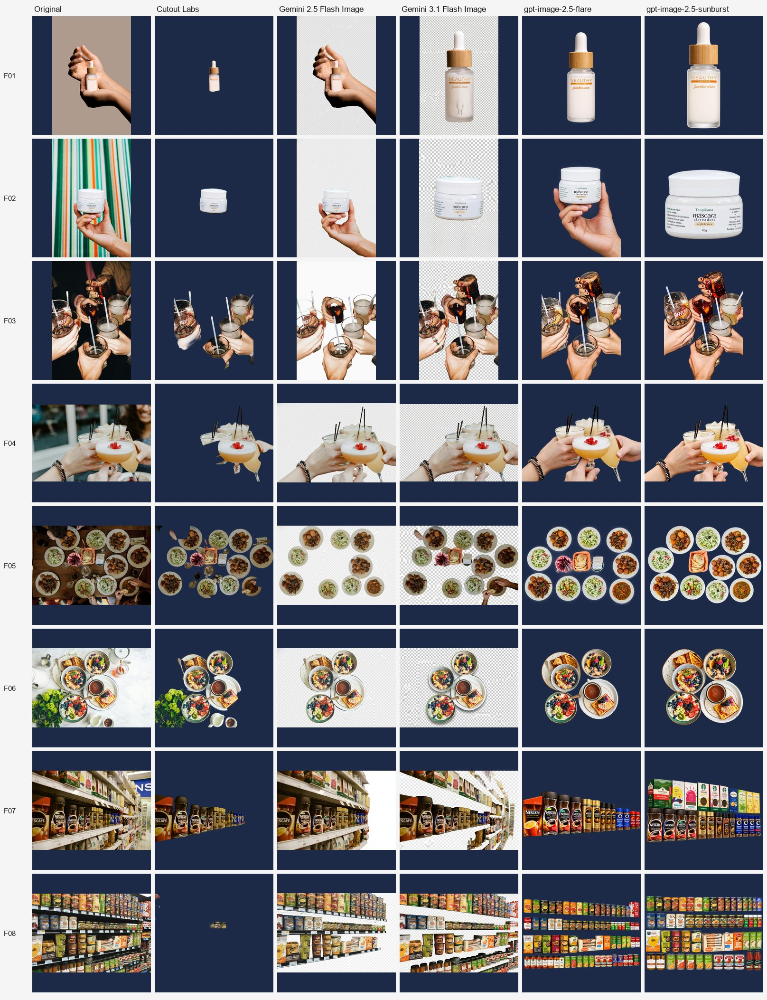

# AI image models vs. a background remover: 50-photo benchmark

Can Gemini or GPT image models replace a dedicated background remover? We sent the same 50 photos and the same request to five engines on November 12, 2026, and published every input, output, measurement, and script here.

Write-up: [Can Gemini or GPT image models replace a background remover? We tested 50 photos](https://www.cutoutlabs.com/blog/ai-image-generator-vs-background-removal-benchmark)

We make [Cutout Labs](https://www.cutoutlabs.com), one of the engines tested. Its failures are included alongside everything else.

## Results

| | Cutout Labs | Gemini 2.5 Flash Image | Gemini 3.1 Flash Image | gpt-image-2.5-flare | gpt-image-2.5-sunburst |
| :--- | :--- | :--- | :--- | :--- | :--- |
| Real transparent background | **50 of 50** | 0 of 50 | 0 of 50 | **50 of 50** | **50 of 50** |
| Output size (inputs: 2048 px long side) | **Same as input** | About 1 MP | About 1 MP | About 1.6 MP | About 1.6 MP |
| Kept the photo's aspect ratio | **50 of 50** | 43 of 50 | **50 of 50** | **50 of 50** | 35 of 50 |
| Subject pixels close to the original¹ | **100%** | 63% | 87% | 44% | 43% |
| Median time per image | **5.2 s** | 11.4 s | 11.6 s | 30.2 s | 37.0 s |
| Price per 1,000 images² | **Free\*** | $39 | $68 | $46 | $50 |

¹ Median share of the subject's pixels within 20 levels (out of 255) of the original photo. Photos that can't be compared are left out: the one where the Cutout Labs cutout was almost empty and, for Gemini 2.5, 7 photos it reframed. See `fidelity.py` and `fidelity_aligned.py`.

² Published list prices on November 12, 2026; see `costs.py`.

\* Free for now. Paid plans will come later.

- **Gemini** never returned transparency. It usually painted a gray-and-white checkerboard into an opaque image instead.
- **GPT** returned real transparency by redrawing the product: labels, lighting, framing, and hidden parts were regenerated, and some details changed.
- **Cutout Labs** kept the photo's own pixels, and failed outright on some busy scenes and hand-held products (see category F).

## Gallery

Every photo and every output, one sheet per category. Transparent areas are shown in dark blue, so a painted checkerboard is easy to tell apart from real transparency.

- [A: Ordinary products](gallery/A.jpg)
- [B: Pale products on pale backgrounds](gallery/B.jpg)
- [C: Handles, holes, and thin parts](gallery/C.jpg)
- [D: Glass and reflective items](gallery/D.jpg)
- [E: Fur, hair, and plants](gallery/E.jpg)
- [F: Busy scenes and hands](gallery/F.jpg)

## What's here

| Path | Contents |
| :--- | :--- |
| `SELECTION.md` | Selection rules, fixed before any photo was reviewed |
| `candidates.csv` | Every candidate photo considered, with the decision and reason |
| `manifest.csv` | The 50 photos: intended subject, Unsplash source, photographer, and checksums |
| `images/inputs/` | The exact 2048 px JPEG files every engine received |
| `previews/` | Every output, resized to 1024 px WebP (transparency kept) |
| `gallery/` | The comparison sheets above |
| `results/` | Per-image measurements, summaries, costs, and GPT token usage |
| `run_full_study.py` | Runs the Cutout Labs API and both Gemini models |
| `run_gpt_edits.py` | Runs both GPT models through the Azure OpenAI images edit endpoint |
| `analyze_v2.py` | Transparency, background type, size, aspect ratio, and latency |
| `fidelity.py`, `fidelity_aligned.py` | How close each output's subject is to the original photo |
| `costs.py` | Cost per image from published prices and reported token usage |
| `download_originals.py` | Downloads the full-size Unsplash originals |

Full-size outputs, exactly as each engine returned them, are in the [v1.0 release](../../releases/tag/v1.0). Unzip them into this folder to re-run the analysis scripts.

## Method

- **Prompt:** "Isolate {subject} on a clean transparent background.", with the subject written down for each photo before any engine ran.
- **Cutout Labs:** the Cutout Labs API's standard background removal (no processing options), on a separate deployment set up for this test, returning a transparent PNG.
- **Gemini:** `generateContent` with the photo and prompt, models `gemini-2.5-flash-image` and `gemini-3.1-flash-image`, default settings.
- **GPT:** Azure OpenAI `images/edits` with the photo, the prompt, `background=transparent`, `output_format=png`, and `size=auto`.
- **Limits:** one run per engine per photo, from a single client in India. Prices and models change often.

To re-run the engines, create a `.env` with `CUTOUT_API_KEY` ([free key](https://www.cutoutlabs.com/background-removal-api)), `GEMINI_API_KEY`, `AZURE_ENDPOINT`, and `AZURE_KEY`. The analysis scripts make no API calls.

## Licenses

- **Code:** MIT (see `LICENSE`).
- **Measurements** in `results/`: [CC BY 4.0](https://creativecommons.org/licenses/by/4.0/).
- **Photos:** from Unsplash under the [Unsplash License](https://unsplash.com/license); photographers are credited in `manifest.csv`. The outputs are derived from these photos and shared so the results can be checked.
